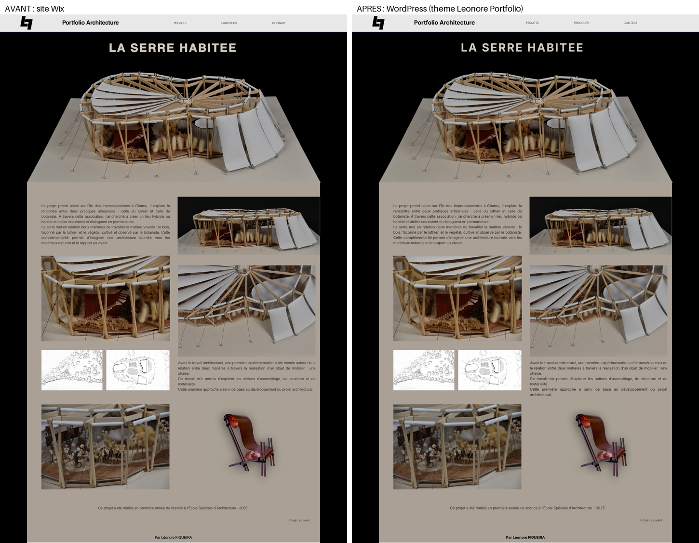

# Léonore Figueira — Portfolio Architecture

Portfolio d'architecture de Léonore Figueira : étudiante en double diplôme ESA – ESTP.

**Site en ligne (copie provisoire) :** https://helainefgr.github.io/leonore-figueira-portfolio/

Ce dépôt contient le site migré depuis Wix, en attendant sa mise en ligne définitive sur WordPress chez OVH.

## Contenu

| Élément | Rôle |
| --- | --- |
| `leonore-portfolio.zip` | **Thème WordPress à installer** (Apparence → Thèmes → Ajouter un thème → Téléverser). Il crée automatiquement les pages, le menu et la page d'accueil. |
| `GUIDE-INSTALLATION.md` | Pas-à-pas pour installer WordPress et le thème chez OVH. |
| `theme-wordpress/` | Le même thème, décompressé (code source). |
| `docs/` | Copie statique du site, publiée avec GitHub Pages. |

## Pages

- Projets (accueil)
- Parcours
- La serre habitée (`/l1s2/`)
- La Palestra (`/intensif/`)
- Résidence jardins (`/l2s1/`)
- Projets divers (`/divers/`)

